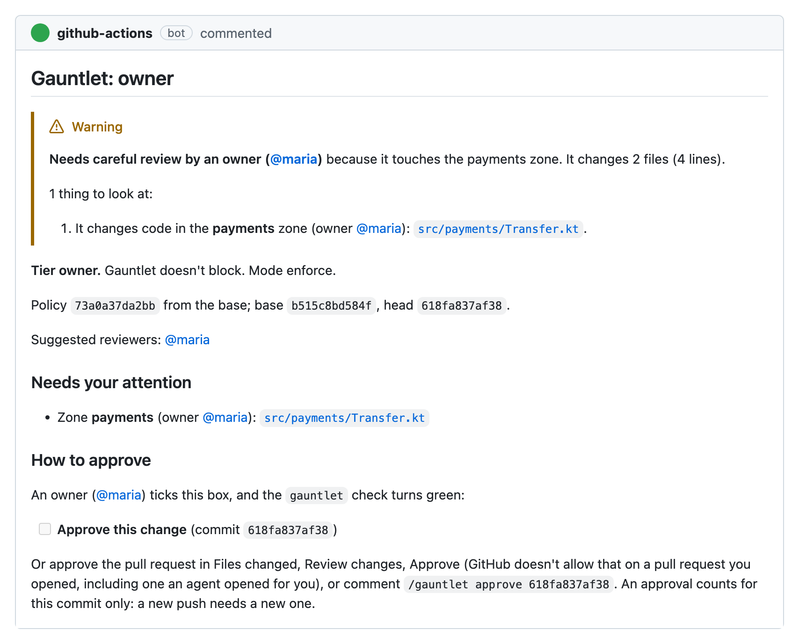

<picture>
  <source media="(prefers-color-scheme: dark)" srcset="assets/gauntlet-logo/gauntlet-lockup-dark.svg">
  
</picture>

# Gauntlet: checks for AI-written code

[](https://github.com/matthewjones372/gauntlet/releases)
[](https://github.com/matthewjones372/gauntlet/actions/workflows/ci.yml)
[](LICENSE)

Gauntlet runs your project's checks and flags attempts to weaken them. It fits
between an AI coding agent finishing a task and you merging its pull request.

An agent can make tests pass by fixing the code or changing the tests.
Gauntlet runs your build and tests, detects deleted or
weakened assertions, and protects the configuration used to judge the change.

It works with your existing tests, CI and code review.

## Where it fits in your workflow

You set the rules once: which checks must pass, which files are protected, and
which parts of the code need a person's approval.

1. **Give Claude Code a task.** It edits the code using your existing tools.
2. **Gauntlet checks before the agent finishes.** In enforce mode, a failing
   check sends it back to fix the cause. A change that needs protected
   configuration or policy edits goes to you instead.
3. **Open a pull request.** With the GitHub integration, Gauntlet posts a
   summary of the checks, suspicious edits and any required review.
4. **Review and merge.** Changes to areas you've marked as sensitive, such as
   payments or authentication, need their owner's approval. Require the `gauntlet` status
   check in your branch ruleset to enforce it before merging.

For example, if an agent replaces a currency-conversion assertion with
`assertTrue(true)`, ordinary tests may still pass. Gauntlet detects the
weakened assertion. In its GitHub-only `--protect-only` mode, it also restores
and runs the original test, so the currency-conversion bug still fails.

<p align="center"></p>

Claude Code is the only supported agent integration today. You can also run
Gauntlet yourself from the CLI or use it only on GitHub, without agent hooks.

## Get started

### With Claude Code

In your project folder, on its main branch:

```bash
curl -fsSL https://raw.githubusercontent.com/matthewjones372/gauntlet/main/install.sh | sh
gauntlet setup
```

You can also [install manually](docs/faq.md#other-things-worth-knowing).

Open Claude Code in the same folder and type `/gauntlet-setup`. It looks at
your build and tests, helps you choose the rules, and gives you a
`gauntlet apply` command to run yourself.

Setup starts in shadow mode. Checks run and report what would be blocked,
but don't block anything. Tune the rules, then switch the policy to
`mode enforce` when you're ready.

To check pull requests too:

```bash
gauntlet connect github
```

Commit the generated configuration and require the `gauntlet` status check
in your GitHub branch ruleset. Teammates install the CLI, pull the setup and
accept Claude Code's prompt to trust the project's MCP server and hooks.

### GitHub only

After installing, run:

```bash
gauntlet init
gauntlet connect github --protect-only
```

Commit `.gauntlet` and `.github`, then require the `gauntlet` status
check in your branch ruleset. This checks for weakened verification without
setting up agent hooks, review rules or a baseline. Unlike shadow mode,
`--protect-only` fails changes that don't pass its checks.

[Full setup guide](docs/getting-started.md) · [Start a new project](docs/getting-started.md#a-new-project)

## What you can enforce

Your policy chooses which checks to run and what should block a change.

| Rule | What it means in practice |
| --- | --- |
| Test protection | Detect deleted, skipped or weakened tests and new suppressions. Protect test setup, fixtures and build configuration. |
| Coverage and test strength | Require coverage on changed code. Stop coverage, mutation scores or test counts falling below a recorded baseline. |
| Human review | Require approval for changes to sensitive areas, protected tests or policy. |
| Lint and compiler checks | Allow existing lint, compiler and dead-code findings, but fail new ones. |
| Architecture and performance | Enforce dependency rules between modules and performance budgets for benchmarks. |

[Policy reference](docs/policy.md) covers these rules, plus scenario-linked
tests, hidden behavioural checks (holdouts), and running only affected tests.

## How checks run

Gauntlet uses the base branch's policy and protected configuration, runs
checks in a fresh worktree, and accepts report files only from processes it
started. A planted result file doesn't count as a pass. Decisions are
deterministic: no model or API key is needed to judge a change.

Protected tests can change when requirements change. By default, an edited
protected test runs as edited and requires review. `--protect-only` restores
the original tests too. On GitHub, the job running pull request code has no
secrets. A separate job posts the decision without running that code.

Passing Gauntlet doesn't prove the code is correct. You still need tests that
cover the requirements and people to review the change. Local hooks can also
be disabled unless you configure managed settings. See the
[integration and threat model](docs/integrations.md).

To test the protection on your own project, `gauntlet selftest` tries changes
such as deleting a test, weakening an assertion and planting a report. The
[public tamper corpus](docs/evidence.md#the-tamper-corpus) records detector
results and known false positives. [Related research](docs/research.md)
explains the problem but does not evaluate Gauntlet.

## Support and status

Release candidate (v0.1.0-rc.38). Supports Kotlin and Java (Gradle), TypeScript and
JavaScript, Python, Go, Rust, Scala and Clojure. Tool support varies by
[language pack](docs/languages.md). On Windows, use WSL 2.

Claude Code hooks are available today. Codex, Cursor, Copilot and Gemini
integrations, plus .NET, Ruby, PHP, Maven and native Windows support, are
planned. See the [roadmap](PLAN.md).

## Documentation

- [Getting started](docs/getting-started.md): setup, joining a project and new projects
- [Policy reference](docs/policy.md): checks, protected files and review rules
- [Integrations](docs/integrations.md): Claude Code, subagents and GitHub
- [Evidence](docs/evidence.md): reports, selftest and detector testing
- [Supported languages](docs/languages.md) and [FAQ](docs/faq.md)
- [Development](docs/development.md), [design decisions](docs/adr/) and [specs](docs/specs/)

## License

[Apache-2.0](LICENSE)
