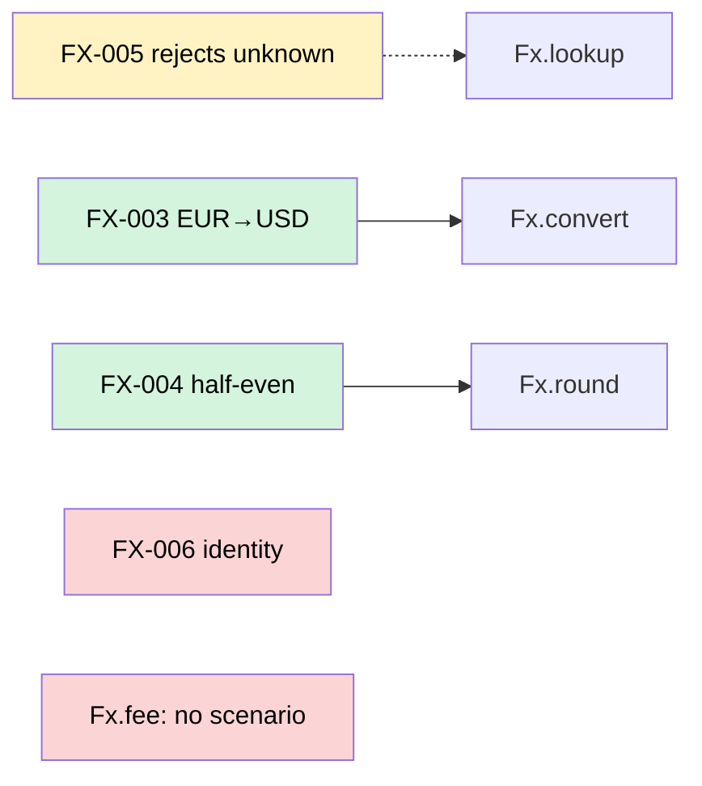

# Spec 0012: scenarios, and the evidence for each in the pull request

Status: in progress. §1 and §2 (scenario files, ids, `gauntlet validate`, protection) on branch
`spec-0012-scenarios`; §3-§6 (binding, verdicts, changed code with no scenario, killers), the JSON
report's `scenarios` and the agent summary on `spec-0012-scenarios-2`. Depends on spec 0011
(mutation on changed lines).

## Problem

Gauntlet can say the tests ran, weren't weakened and cover the changed lines. It
can't say the change does what someone meant it to. Intent lives in a ticket or a
prompt, and the reviewer has to work out for themselves which test stands for which
promise, and whether that test would notice if the promise broke.

Cucumber-style tooling answers half of this. A Gherkin scenario states intent in a
form a person reads, but its step definitions are code the agent writes: a `Then`
step that asserts nothing passes, the same `assertTrue(true)` one layer down. It
also needs a runtime per language (cucumber-js, Cucumber-JVM, godog, behave).

## What it is

A **scenario** is a human-written statement of behaviour with an id. Gauntlet
doesn't run scenarios. It checks that each one is bound to tests that ran, passed,
can fail, and catch a bug on the lines the change touched, and it shows that in the
pull request: the given/when/then, the evidence, and a diagram of what reaches what.

```text
scenarios "specs/**/*.feature"

gates {
  verify    { unit, mutation advise on changed }
  behaviour { scenarios }
}
```

## Behaviour

### 1. Scenario files

Scenario files use Gherkin's syntax; nothing executes them. Gauntlet reads a
subset: `Feature`, `Background`, `Scenario`, `Scenario Outline` with its `Examples`
(one scenario, the table shown as written), `Given`/`When`/`Then`/`And`/`But`, and
tags. A scenario's id is its tag matching `@[A-Z][A-Z0-9]*-[0-9]+`:

```gherkin
Feature: Currency conversion

  @FX-003
  Scenario: Converting EUR to USD
    Given a rate of 1.10 USD per EUR
    When I convert €1.00
    Then I get $1.10
```

A scenario without an id, or two scenarios with the same id, is a policy error at
`gauntlet validate`, not a check failure: the file is wrong before any change is.

The parser is Gauntlet's own (about the size of the DSL lexer), not
`@cucumber/gherkin`: the subset is small and a dependency in the compiled binary
nominates review on every pack.

Settled while implementing:

- Gherkin's synonyms are read as what they stand for (`Example` for `Scenario`,
  `Scenario Template` for `Scenario Outline`, `Scenarios` for `Examples`), and a
  step's data table or doc string stays with it, shown as written. `Rule`, and
  any line Gauntlet can't place, is an error rather than skipped: a scenario
  quietly half-read would be judged on less than the person wrote.
- An id tag counts only on a scenario. One on the `Feature` (which Gherkin
  would pass down to every scenario) is an error, and so is a scenario with two.
- Two scenarios with the same id: the error is at the second, naming the first.
- `validate` reads the working tree's scenario files; the policy compiler stays
  pure. At check time, scenarios that `validate` would reject don't fail the
  check: one without an id can't be bound and is left out, and of two with the
  same id the first (by path) is judged.
- The syntax error that lists the top-level blocks doesn't name `scenarios`
  yet: three protected golden files hold that list, so the owner adds it.

### 2. Scenario files are intent, so they're protected

Paths under `scenarios` are protected the way tests are (ADR 0021): the judged
checkout uses the base commit's scenario files, and a change that adds, edits or
deletes one nominates review. An agent writing its own acceptance criteria is
grading its own work. A deleted scenario is a `deleted-tests` forbid, as for a test.

The pull request always shows the base version of a scenario. When the head
changes it, the report shows both, base first, and says which one was judged.

The `scenarios` line adds a protect group named `scenarios` (a keyword, so no
other group can take the name), restored from base like `config`: a new
scenario file is left out of the run and needs review too. A scenario moved to
another file deletes nothing; only an id in no scenario file at head is a
`deleted-tests` forbid. A change to a scenario file doesn't make an `affected`
suite run every test: no test reads them.

### 3. Tests bind to scenarios by name

A test is bound to a scenario when the scenario's id appears as a word in the
test's name as the runner reports it (`FX-003 converts at the quoted rate`,
`converts_FX003` does not bind). Names are in every runner's report, so every pack
binds the same way with no per-framework tag reading. A scenario can have several
tests; a test can name several scenarios.

### 4. Each scenario gets a verdict

From evidence the check already has (ADR 0012 proof of execution, integrity
findings, spec 0011 mutants), in this order, first match wins:

| Verdict | When | Blocks under `scenarios` |
|---|---|---|
| `unbound` | no test names the id | yes |
| `not-run` | bound tests exist but none executed (filtered, skipped, no report) | yes |
| `failing` | a bound test failed | yes |
| `vacuous` | every bound test that ran has an integrity finding (can't fail, asserts nothing) | yes |
| `unchallenged` | a mutant on a changed line is reached by a bound test, and no bound test killed one | no, a finding |
| `proven` | bound tests ran and passed, and if any mutant on a changed line was reached, a bound test killed one | |
| `unaffected` | `proven`, but no bound test reached a changed line | |

`scenarios advise` reports the same verdicts and blocks nothing; `gauntlet init`
drafts `advise`, like mutation in spec 0011.

Settled while implementing:

- A bound test "exists" when a suite reported it (skipped included), the base's
  test ids name it, or a pack's reading of the test sources (the one
  `gauntlet prune tests` uses) finds a test whose name has the id.
- `vacuous` reads each bound test's source the way `gauntlet prune tests` and
  the `weakened-assertions` check do: no assertion, or only ones that can't
  fail. The integrity findings themselves only cover added lines, and a
  scenario's test that never could fail is as vacuous as one just weakened.
  A pack that can't read its test sources never makes a scenario `vacuous`.
- A bound test that `affected` selection (spec 0013) left out didn't need to
  run: the scenario is `unaffected`, not `not-run`.
- `unaffected` also covers a mutation run with no mutant on the changed lines.
- The check runs last in its tier, so it reads that tier's suites and mutation
  gate; a policy that puts them in a later tier is warned at `validate`.
- `unchallenged`, changed code with no scenario, and (under `advise`) the
  verdicts that would block are advisory findings, so they show on the diff
  like spec 0011's survivors.
- The trusted job takes the verdicts with the check's outcome from the
  evidence job, as for every gate: they come from running the change's code.

Without a mutation check in the policy, `unchallenged` can't be told apart from
`proven`, so neither is claimed: the verdict is `passing` and the report says
mutation wasn't run.

### 5. Changed code with no scenario

A changed line with at least one mutant, none of whose mutants are killed by a
scenario's bound test, is **changed code with no scenario**. It's reported per
function, as a finding that never blocks: it's the part of the change nobody stated
an intent for, and the reviewer should see it first. A changed line with no mutants
is never claimed either way.

### 6. Killers come from the mutation tools

Spec 0011's shared mutant helper records, for each mutant, the tests that killed it
where the tool reports them (Pitest `killingTests` with the full mutation matrix,
Stryker `killedBy`). A killer binds a scenario the way a test does: the id is a
word in the name the tool gives it. With a scenarios check in the policy, the
mutation gate asks for every killer, as when recording a baseline (spec 0016).
A pack whose tool doesn't report killers says so; its
scenarios get `passing`, the "catches a bug" column says "not reported", and the
diagram draws no edge. Gauntlet never infers a killer.

### 7. Holdouts

A holdout test can bind a scenario. The scenario text is shown (the agent can read
the scenario file anyway); the bound test is shown by id only, with no failure
message, as spec 0003 already does for holdout output. Holdout tests aren't
mutated, so a scenario bound only by holdouts is `passing`, marked "holdout".

## In the pull request

A `### Behaviour` section in `renderMarkdown`, after `### Why` and before
`### Checks`. Order: a one-line count, the table, details per scenario, the diagram
with its link list.

````markdown
### Behaviour

3 of 4 scenarios proven · 1 unbound · changed code with no scenario: 1 function

| | Scenario | Tests | Ran | Catches a bug on this change |
|---|---|---|---|---|
| ❌ | **FX-006** Same currency is identity | none | | |
| ⚠️ | **FX-005** Rejects unknown currency | `FxTest.FX-005 rejects` | ✔ | kills 0 of 1 |
| ✅ | **FX-003** Converting EUR to USD | `FxTest.FX-003 converts` | ✔ 4 assertions | kills 3 of 3 |
| ✅ | **FX-004** Rounds half-even | `FxTest.FX-004 rounds` | ✔ 2 assertions | kills 2 of 2 |

<details><summary>✅ FX-003 · Converting EUR to USD</summary>

```gherkin
Given a rate of 1.10 USD per EUR
When I convert €1.00
Then I get $1.10
```

- Scenario: [`specs/fx.feature:4`](…/blob/<base>/specs/fx.feature#L4), unchanged
- Test: [`FxTest.kt:9`](…/blob/<head>/src/test/kotlin/svc/settlement/FxTest.kt#L9), unchanged since base
- Ran in the evidence job: JUnit report, 4 assertions
- Catches: `/ 10_000` → `/ 1_000` at [`Fx.kt:7`](…/pull/12/files#diff-…R7), killed:
  `expected Money(110, USD) but was Money(1100, USD)`
</details>



- **FX-005** → [`Fx.kt:14`](…/files#diff-…R14) `Fx.lookup`: reached, no mutant killed
- **FX-006** → no test names it
- **No scenario** → [`Fx.kt:22`](…/files#diff-…R22) `Fx.fee`
````

Rules:

- **Every path is a link,** through `linker` in `report/render.ts`: a changed file
  to its place in the pull request's "Files changed" tab (`#diff-<sha256>R<line>`),
  an unchanged one to the commit. Scenario files link to the **base** commit, since
  that's the version judged; `linker` gets an option for the base side.
- **The diagram isn't clickable.** GitHub renders Mermaid without interaction, so
  each node is labelled with an id or function name and the list under the diagram
  carries the links, one line per node that isn't `proven`.
- **Edges are evidence only:** a scenario to a changed function when a bound test
  killed or reached a mutant in it. Solid for killed, dotted for reached only.
- **Worst first:** blocking verdicts, then `unchallenged`, then changed code with
  no scenario, then `proven`. `proven` and `unaffected` details are folded;
  `unaffected` scenarios are a count, not rows.
- **Size:** GitHub comments stop at 65,536 characters and Mermaid stops being
  readable past about 30 nodes. The diagram shows everything not `proven`, then
  `proven` scenarios until 30 nodes, then "+N more"; the table is cut the same way
  with a link to the full report artifact.
- **Mutant evidence** shows the tool's description and the killing assertion's
  message, cut to one line. Holdouts show neither (section 7).

The same verdicts go in the JSON report under `scenarios`, and in the agent
summary from the MCP `check` tool, one line per scenario that blocks or is
`unchallenged`, with the scenario's text: the agent is told what the human meant,
so it fixes the code, not the scenario (which it can't change anyway).

## Not covered

- Running Gherkin steps, step definitions, or any Cucumber runtime.
- An LLM judging whether a diff meets a scenario. If added, it's a caution signal
  (ADR 0011): it can nominate review, never pass a scenario.
- Generating scenarios from tickets or prompts.
- Binding by framework tags (`@Tag`, pytest markers). Names first; tags later if a
  runner's names can't carry the id.

## Tests

- Syntax: the Gherkin subset parses `Background`, outlines and tags; a missing or
  duplicate id is a validate error with its location.
- Binding: an id binds as a word, not as a substring; one test binds two
  scenarios; a holdout test binds by id only.
- Verdicts: one fixture per row of the table, including `passing` without mutation
  and "not reported" for a tool with no killers.
- Protection: a head edit to a scenario file is judged on base, shown both ways and
  nominates review; a deleted scenario is a `deleted-tests` forbid.
- Rendering: snapshot of the section for the FX example; every path is a link and
  scenario files link to the base commit; the diagram stays under 30 nodes with
  "+N more"; a report with many scenarios stays under the comment limit.
- End to end, `examples/fixtures/kotlin-service` (the README's FX change): the `/ 1_000` change
  with `assertTrue(true)` makes FX-003 `vacuous` and blocks; a correct change with
  an untested `Fx.fee` passes and lists `Fx.fee` under no scenario.
