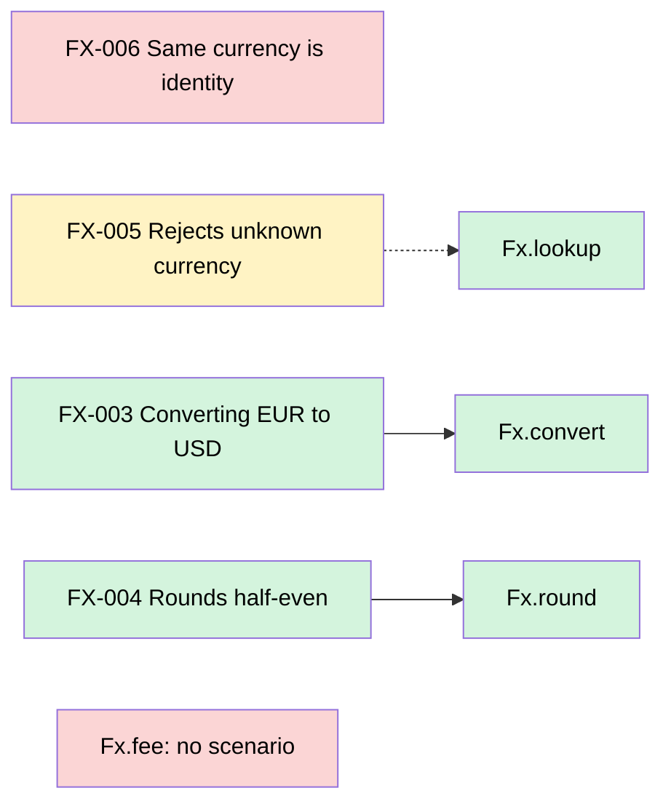

### Behaviour

2 of 5 scenarios proven · 1 unbound · 1 unchallenged · 1 unaffected · changed code with no scenario: 1 function

| | Scenario | Tests | Ran | Catches a bug on this change |
|---|---|---|---|---|
| ❌ | **FX-006** Same currency is identity | none |  |  |
| ⚠️ | **FX-005** Rejects unknown currency | `FxTest.FX-005 rejects` | ✔ 1 assertion | kills 0 of 1 |
| ✅ | **FX-003** Converting EUR to USD | `FxTest.FX-003 converts` | ✔ 4 assertions | kills 3 of 3 |
| ✅ | **FX-004** Rounds half-even | `FxTest.FX-004 rounds` | ✔ 2 assertions | kills 2 of 2 |

<details open><summary>❌ FX-006 · Same currency is identity · unbound</summary>

```gherkin
When I convert EUR to EUR
Then nothing changes
```

- Scenario: [`specs/fx.feature:20`](https://github.com/acme/fx/blob/bbbbbbbbbbbbbbbbbbbbbbbbbbbbbbbbbbbbbbbb/specs/fx.feature#L20), unchanged
- Test: none names it. Put the id in a test's name, such as `FX-006 same currency is identity`.
</details>

<details open><summary>⚠️ FX-005 · Rejects unknown currency · unchallenged</summary>

```gherkin
When I convert to XYZ
Then it fails
```

- Scenario: [`specs/fx.feature:15`](https://github.com/acme/fx/blob/bbbbbbbbbbbbbbbbbbbbbbbbbbbbbbbbbbbbbbbb/specs/fx.feature#L15), unchanged
- Test: [`src/test/kotlin/svc/settlement/FxTest.kt:20`](https://github.com/acme/fx/blob/cccccccccccccccccccccccccccccccccccccccc/src/test/kotlin/svc/settlement/FxTest.kt#L20), unchanged since base, `FxTest.FX-005 rejects`: passed, 1 assertion
- Reached, not killed: `negated conditional` at [`src/main/kotlin/svc/settlement/Fx.kt:14`](https://github.com/acme/fx/pull/12/files#diff-88537eaaaed8ab40bdb1e2f1f077cacff0e806f1126279d6189d9ed594a4d1eeR14) (`Fx.lookup`)
</details>

<details><summary>✅ FX-003 · Converting EUR to USD · proven</summary>

```gherkin
Given a rate of 1.10 USD per EUR
When I convert €1.00
Then I get $1.10
```

- Scenario: [`specs/fx.feature:4`](https://github.com/acme/fx/blob/bbbbbbbbbbbbbbbbbbbbbbbbbbbbbbbbbbbbbbbb/specs/fx.feature#L4), unchanged
- Test: [`src/test/kotlin/svc/settlement/FxTest.kt:9`](https://github.com/acme/fx/blob/cccccccccccccccccccccccccccccccccccccccc/src/test/kotlin/svc/settlement/FxTest.kt#L9), unchanged since base, `FxTest.FX-003 converts`: passed, 4 assertions
- Catches: `Replaced long division with multiplication` at [`src/main/kotlin/svc/settlement/Fx.kt:7`](https://github.com/acme/fx/pull/12/files#diff-88537eaaaed8ab40bdb1e2f1f077cacff0e806f1126279d6189d9ed594a4d1eeR7) (`Fx.convert`), killed by `FxTest.FX-003 converts`: `expected Money(110, USD) but was Money(1100, USD)`
- Catches: `Replaced long multiplication with division` at [`src/main/kotlin/svc/settlement/Fx.kt:7`](https://github.com/acme/fx/pull/12/files#diff-88537eaaaed8ab40bdb1e2f1f077cacff0e806f1126279d6189d9ed594a4d1eeR7) (`Fx.convert`), killed by `FxTest.FX-003 converts`
- Catches: `negated conditional` at [`src/main/kotlin/svc/settlement/Fx.kt:8`](https://github.com/acme/fx/pull/12/files#diff-88537eaaaed8ab40bdb1e2f1f077cacff0e806f1126279d6189d9ed594a4d1eeR8) (`Fx.convert`), killed by `FxTest.FX-003 converts`
</details>

<details><summary>✅ FX-004 · Rounds half-even · proven</summary>

```gherkin
Given an amount of 0.125
Then I get 0.12
```

- Scenario: [`specs/fx.feature:10`](https://github.com/acme/fx/blob/bbbbbbbbbbbbbbbbbbbbbbbbbbbbbbbbbbbbbbbb/specs/fx.feature#L10), unchanged
- Test: [`src/test/kotlin/svc/settlement/FxTest.kt:15`](https://github.com/acme/fx/blob/cccccccccccccccccccccccccccccccccccccccc/src/test/kotlin/svc/settlement/FxTest.kt#L15), unchanged since base, `FxTest.FX-004 rounds`: passed, 2 assertions
- Catches: `removed call to setScale` at [`src/main/kotlin/svc/settlement/Fx.kt:10`](https://github.com/acme/fx/pull/12/files#diff-88537eaaaed8ab40bdb1e2f1f077cacff0e806f1126279d6189d9ed594a4d1eeR10) (`Fx.round`), killed by `FxTest.FX-004 rounds`
- Catches: `replaced HALF_EVEN with HALF_UP` at [`src/main/kotlin/svc/settlement/Fx.kt:11`](https://github.com/acme/fx/pull/12/files#diff-88537eaaaed8ab40bdb1e2f1f077cacff0e806f1126279d6189d9ed594a4d1eeR11) (`Fx.round`), killed by `FxTest.FX-004 rounds`
</details>



- **FX-006** → no test names it
- **FX-005** → [`src/main/kotlin/svc/settlement/Fx.kt:14`](https://github.com/acme/fx/pull/12/files#diff-88537eaaaed8ab40bdb1e2f1f077cacff0e806f1126279d6189d9ed594a4d1eeR14) `Fx.lookup`: reached, no mutant killed
- **No scenario** → [`src/main/kotlin/svc/settlement/Fx.kt:22`](https://github.com/acme/fx/pull/12/files#diff-88537eaaaed8ab40bdb1e2f1f077cacff0e806f1126279d6189d9ed594a4d1eeR22) `Fx.fee`

